# ノイズ相関・既存データ図集（2026-10-27）

初期平均フォノン数 nbar、運動位相緩和、運動加熱、スピン位相緩和、光散乱を、保存済みデータから整理した図集。新たなマスター方程式計算は実行していません。

- 基準：矩形単一モードMSゲート、100 µs、eta=0.1、A=0.125、delta=0.5。`use_full_order=True` は有限LDの O(eta²) 補正を含むモデルで、厳密な全次数ではありません。
- 基準レート：運動加熱10 /s、運動位相緩和18 /s、スピン位相緩和10/3 /s、光散乱4 /s（Rayleigh 3 + Raman 1）。
- 主系列：nbar = 0.01, 1, 2, 3, 4、レート倍率 = 0, 0.5, 1, 2, 4。
- 全6ペアの5×5格子が全温度で揃い、750点あります。元QPTは共通軸を重複除去すると565点です。
- 「相関」は、(1) 温度と散逸の混合応答、(2) infidelityの非加算性、(3) 誤差生成子内部のPauli間相関を区別します。浴の統計相関を測定したものではありません。
- C_ij = I_ij - I_i - I_j + I_0。負値は単独寄与の和より誤差が小さいことを表します。
- K_0 = log R_0、ΔK_i = log R_i - log R_0。生成子はCPTP射影後の保存解析、infidelityは各CSVの保存値です。生成子係数は確率ではありません。
- S_P(ρ)=PρP-ρ、C_PQ(ρ)=PρQ+QρP−{PQ+QP,ρ}/2、H_P(ρ)=−i[P,ρ]。
- S_IX ≃ S_XI ≃ C_IX,XI は集団的D[IX+XI]を表し、D[XX]とは別です。

## 主な読み取り

1. 無散逸の有限LD誤差と、運動位相緩和の単独増分が温度に対して増加します。他の3散逸の増分は比較的平坦です。
2. 全6ペアの保存された非ゼロ格子でC_ijは負。最大絶対値は運動加熱×運動位相緩和、nbar=4、両レート4倍です。
3. 基準レートの4ノイズ同時作用はほぼ加算的です。ペア補正で再構成残差はさらに小さくなります。
4. 運動ノイズには集団Xの相関成分が現れます。スピン位相緩和・光散乱にはIZ/XY等のPauli対の成分が現れます。
5. ゼロレート近傍の微小差分は数値的に不安定な条件があります。全6ペアの完全H/S/C/A混合生成子や、その直接収束確認は本図集のデータでは揃っていません。

## ファイル

- `figures/`: 全図のPNGと編集可能なSVG。
- `data/`: 基準誤差予算、全6ペアの基準値と極値、温度混合応答、別計算との比較、出典一覧。
- `manifest.json`: 入力ファイルのSHA-256、行数、検算結果。
- `noise_correlation_atlas.ipynb`: 図を順番に閲覧するノートブック。
- `build_atlas.py` と `build_pdf.py`: 再生成スクリプト。
- PDF: `../pdf/noise_correlation_atlas_20261027.pdf`。

再生成: プロジェクトのPythonで `python3 output/noise_correlation_20261027/build_atlas.py` を実行後、reportlabを含むPythonで同じディレクトリの `build_pdf.py` を実行。

## 基準レートでの数値

| nbar | 全ノイズ I_all | 無散逸 I_0 | 運動加熱 ΔI | 運動位相緩和 ΔI | スピン位相緩和 ΔI | 光散乱 ΔI |
|---:|---:|---:|---:|---:|---:|---:|
| 0.01 | 1.946502e-03 | 2.487641e-04 | 3.899685e-04 | 4.830845e-04 | 2.665401e-04 | 5.595788e-04 |
| 1 | 3.644327e-03 | 1.301879e-03 | 3.821842e-04 | 1.138158e-03 | 2.661956e-04 | 5.588544e-04 |
| 2 | 5.980711e-03 | 3.025893e-03 | 3.742918e-04 | 1.761506e-03 | 2.656077e-04 | 5.576497e-04 |
| 3 | 8.877645e-03 | 5.350425e-03 | 3.663482e-04 | 2.345414e-03 | 2.648201e-04 | 5.560107e-04 |
| 4 | 1.228077e-02 | 8.221437e-03 | 3.584907e-04 | 2.889460e-03 | 2.638811e-04 | 5.540187e-04 |

## 図の一覧
- 01 [Five inputs: the current error budget](#overview)
- 02 [Isolated source response versus rate](#isolated_rate_axes)
- 03 [Rate sweeps with the other noises present](#nominal_background_sweep)
- 04 [All six pairs: signed nonadditivity](#pairwise_summary)
- 05 [Pair grid: Heating x Motional dephasing](#motional_heating__motional_dephasing)
- 06 [Pair grid: Heating x Spin dephasing](#motional_heating__spin_dephasing)
- 07 [Pair grid: Heating x Photon scattering](#motional_heating__photon_scattering)
- 08 [Pair grid: Motional dephasing x Spin dephasing](#motional_dephasing__spin_dephasing)
- 09 [Pair grid: Motional dephasing x Photon scattering](#motional_dephasing__photon_scattering)
- 10 [Pair grid: Spin dephasing x Photon scattering](#spin_dephasing__photon_scattering)
- 11 [Reconstructing the four-noise calculation](#four_noise_reconstruction)
- 12 [Four-rate validation away from the nominal point](#four_rate_validation)
- 13 [High-temperature extension and extrapolation limits](#high_nbar)
- 14 [Initial phonon number: three resolved error components](#thermal_mechanism)
- 15 [Generator structure for all five inputs](#hsca_sectors)
- 16 [Correlation modes: Initial thermal state / no explicit noise](#modes_none)
- 17 [Correlation modes: Heating](#modes_motional_heating)
- 18 [Correlation modes: Motional dephasing](#modes_motional_dephasing)
- 19 [Correlation modes: Spin dephasing](#modes_spin_dephasing)
- 20 [Correlation modes: Photon scattering](#modes_photon_scattering)
- 21 [Does the correlation structure survive rate changes?](#rate_structure)
- 22 [Pairwise response inside the diagonal-Pauli fit](#pair_generator)
- 23 [Small-rate mixed derivatives: numerical stability check](#small_rate_stability)
- 24 [Model order and numerical checks](#numerical_checks)
- 25 [Motional-dephasing nonlinear response: model checks](#polynomial_validation)
- 26 [Single-source calculations: comparison of model order](#single_source_model_order)

## 01 Five inputs: the current error budget

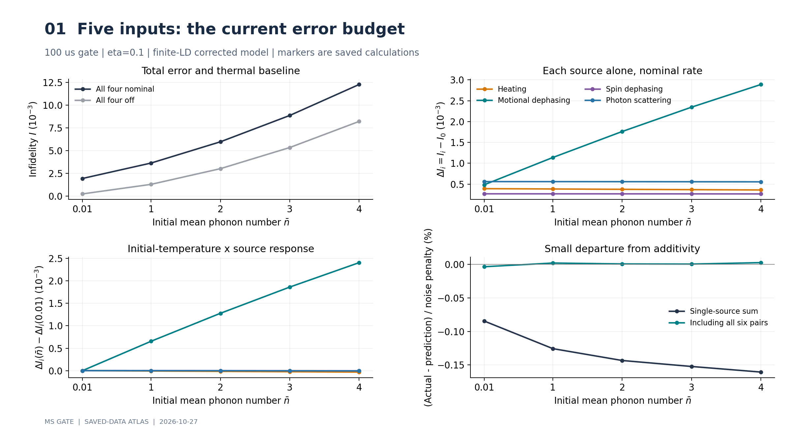

初期平均フォノン数は初期状態のパラメータで、他の4項は散逸レート。右上は他の散逸をゼロにした単独増分。左下はその増分から nbar=0.01 の値を引いた温度との混合応答。右下の分母は全ノイズによる増分 I_all-I_0。主要な温度依存は無散逸の基準誤差と運動位相緩和に現れる。線は保存点を結ぶ表示であり、追加計算や補間精度の保証ではない。

出典: `results/noise_rate_nbar_sweep/all_noise_zero_vs_nominal.csv`, `results/noise_rate_nbar_sweep/four_noise_reconstruction/four_noise_single_components.csv`, `results/noise_rate_nbar_sweep/four_noise_reconstruction/four_noise_reconstruction.csv`

## 02 Isolated source response versus rate

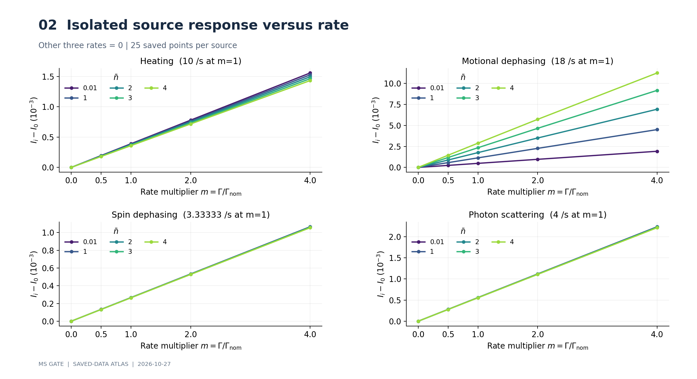

全ペア格子に共通の単独軸から重複なく抽出した100点。運動位相緩和だけが強い温度依存を持つ。レートの物理単位は各パネルの基準値で換算する。

出典: `results/noise_rate_nbar_sweep/all_pairwise_5x5_grids/all_pairwise_grid_qpt_summary.csv`, `results/noise_rate_nbar_sweep/all_noise_zero_vs_nominal.csv`

## 03 Rate sweeps with the other noises present

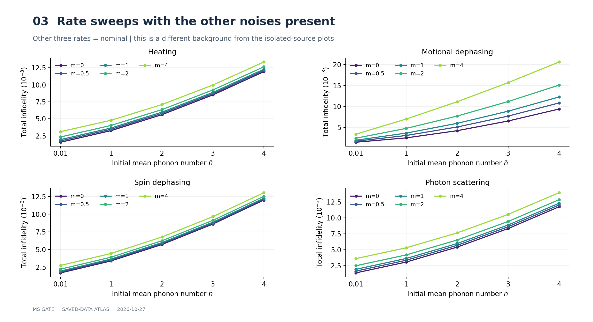

既存ノートブックの100点。各パネルで指定レートだけを変え、他の3レートは基準値に固定。m=0 でも他の散逸と有限LD補正が残るので、単独寄与や無散逸とは異なる。

出典: `results/noise_rate_nbar_sweep/summary.csv`

## 04 All six pairs: signed nonadditivity

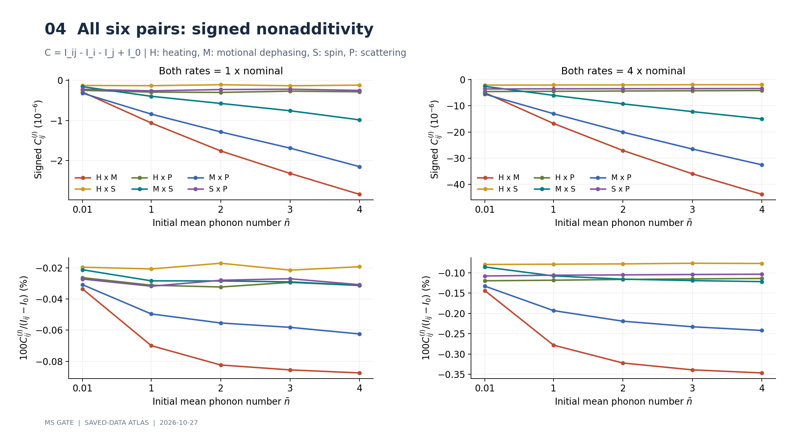

他の2散逸をゼロにしたペア比較。負のCは単独増分の和より小さいことを表す。統計的に相関した環境浴の証拠やPearson相関係数ではない。下段はペアによる誤差増分で割った値。微小な混合差分の確定桁数には直接の収束確認が必要。

出典: `results/noise_rate_nbar_sweep/all_pairwise_5x5_grids/all_pairwise_grid_interactions.csv`

## 05 Pair grid: Heating x Motional dephasing

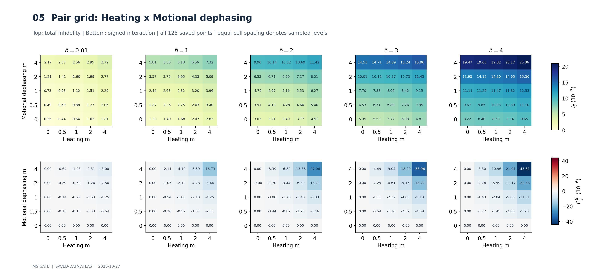

運動加熱×運動位相緩和の全125点。上段は総infidelity、下段は混合差分C。温度間の比較ができるよう、各段で同じ色範囲を使用。レート倍率0、0.5、1、2、4は不等間隔の数値だが、表形式としてセルを等間隔に表示。値は表示桁で丸め、元の精度はCSVに保持。

出典: `results/noise_rate_nbar_sweep/all_pairwise_5x5_grids/all_pairwise_grid_interactions.csv`

## 06 Pair grid: Heating x Spin dephasing

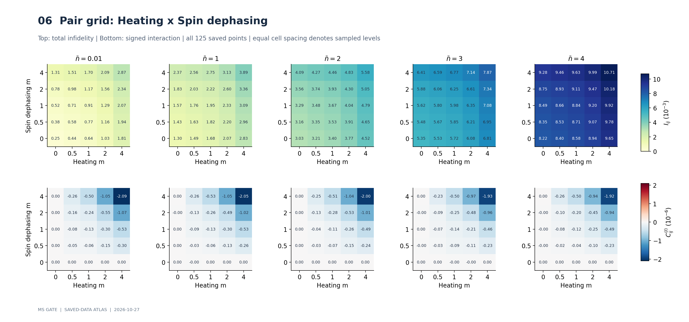

運動加熱×スピン位相緩和の全125点。上段は総infidelity、下段は混合差分C。温度間の比較ができるよう、各段で同じ色範囲を使用。レート倍率0、0.5、1、2、4は不等間隔の数値だが、表形式としてセルを等間隔に表示。値は表示桁で丸め、元の精度はCSVに保持。

出典: `results/noise_rate_nbar_sweep/all_pairwise_5x5_grids/all_pairwise_grid_interactions.csv`

## 07 Pair grid: Heating x Photon scattering

運動加熱×光散乱の全125点。上段は総infidelity、下段は混合差分C。温度間の比較ができるよう、各段で同じ色範囲を使用。レート倍率0、0.5、1、2、4は不等間隔の数値だが、表形式としてセルを等間隔に表示。値は表示桁で丸め、元の精度はCSVに保持。

出典: `results/noise_rate_nbar_sweep/all_pairwise_5x5_grids/all_pairwise_grid_interactions.csv`

## 08 Pair grid: Motional dephasing x Spin dephasing

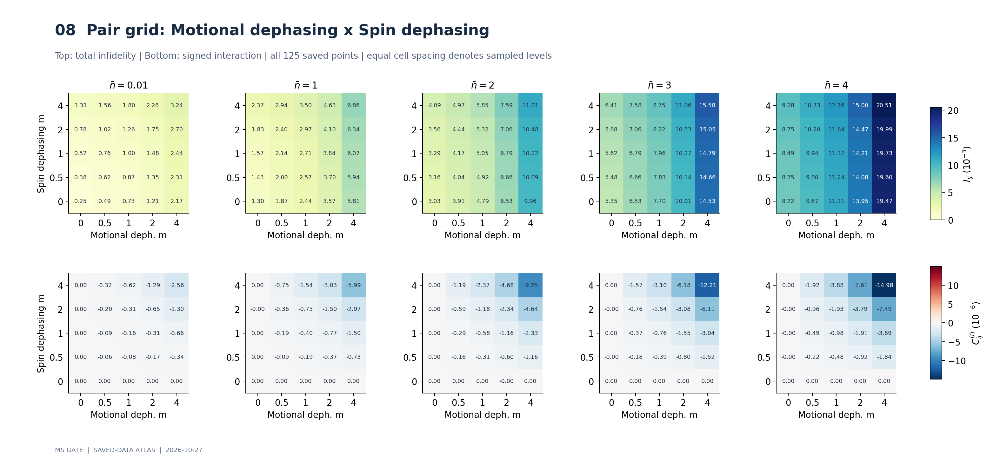

運動位相緩和×スピン位相緩和の全125点。上段は総infidelity、下段は混合差分C。温度間の比較ができるよう、各段で同じ色範囲を使用。レート倍率0、0.5、1、2、4は不等間隔の数値だが、表形式としてセルを等間隔に表示。値は表示桁で丸め、元の精度はCSVに保持。

出典: `results/noise_rate_nbar_sweep/all_pairwise_5x5_grids/all_pairwise_grid_interactions.csv`

## 09 Pair grid: Motional dephasing x Photon scattering

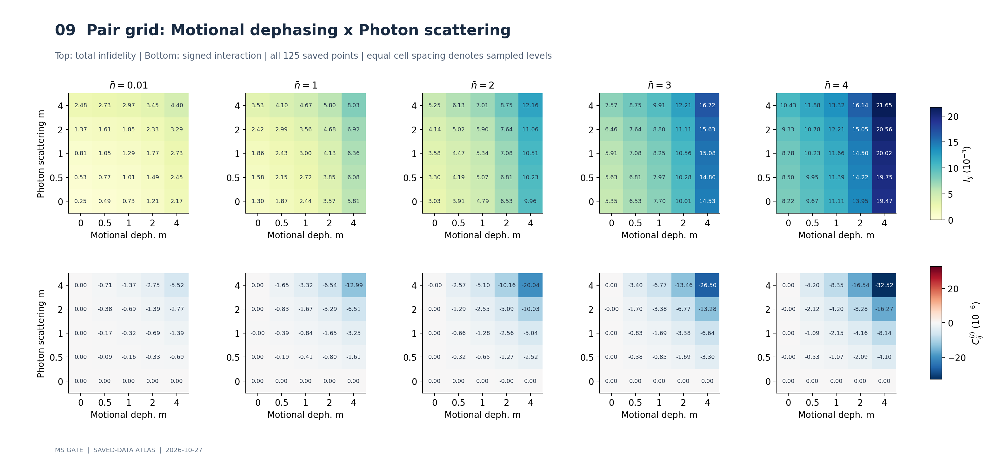

運動位相緩和×光散乱の全125点。上段は総infidelity、下段は混合差分C。温度間の比較ができるよう、各段で同じ色範囲を使用。レート倍率0、0.5、1、2、4は不等間隔の数値だが、表形式としてセルを等間隔に表示。値は表示桁で丸め、元の精度はCSVに保持。

出典: `results/noise_rate_nbar_sweep/all_pairwise_5x5_grids/all_pairwise_grid_interactions.csv`

## 10 Pair grid: Spin dephasing x Photon scattering

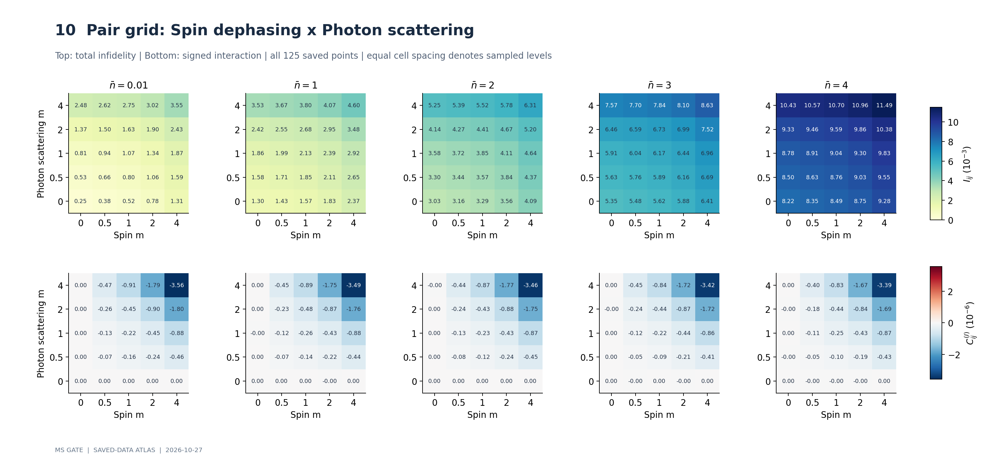

スピン位相緩和×光散乱の全125点。上段は総infidelity、下段は混合差分C。温度間の比較ができるよう、各段で同じ色範囲を使用。レート倍率0、0.5、1、2、4は不等間隔の数値だが、表形式としてセルを等間隔に表示。値は表示桁で丸め、元の精度はCSVに保持。

出典: `results/noise_rate_nbar_sweep/all_pairwise_5x5_grids/all_pairwise_grid_interactions.csv`

## 11 Reconstructing the four-noise calculation

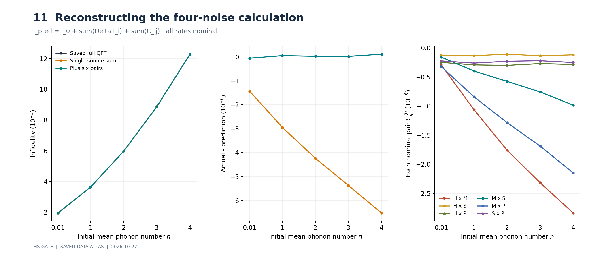

単独寄与の和と6ペア補正から、4散逸を同時に入れた計算を再構成。中央は大きく拡大した差であり、ペア補正後の約1e-7の一致を数値精度の証明とは扱わない。

出典: `results/noise_rate_nbar_sweep/four_noise_reconstruction/four_noise_reconstruction.csv`, `results/noise_rate_nbar_sweep/four_noise_reconstruction/four_noise_pair_components.csv`

## 12 Four-rate validation away from the nominal point

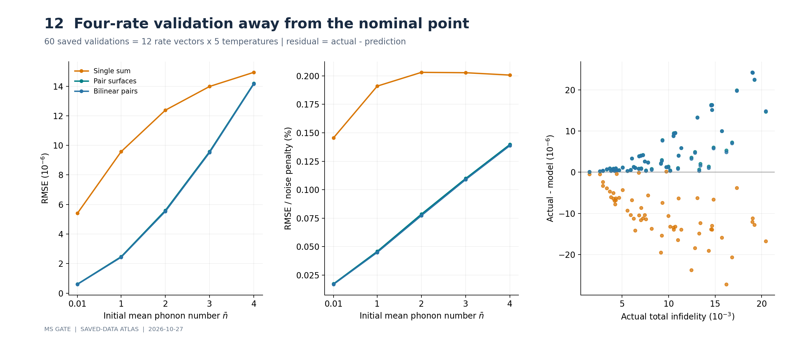

4レート同時変更の60検証点。単独加算、ペア曲面、ペア双線形モデルを比較。基準点の再構成と異なり、任意レート側ではペア補正後にも残差がある。ここでの相対RMSEはノイズ増分を基準とする。

出典: `results/noise_rate_nbar_sweep/four_noise_rate_validation/model_predictions.csv`, `results/noise_rate_nbar_sweep/four_noise_rate_validation/model_comparison_metrics.csv`

## 13 High-temperature extension and extrapolation limits

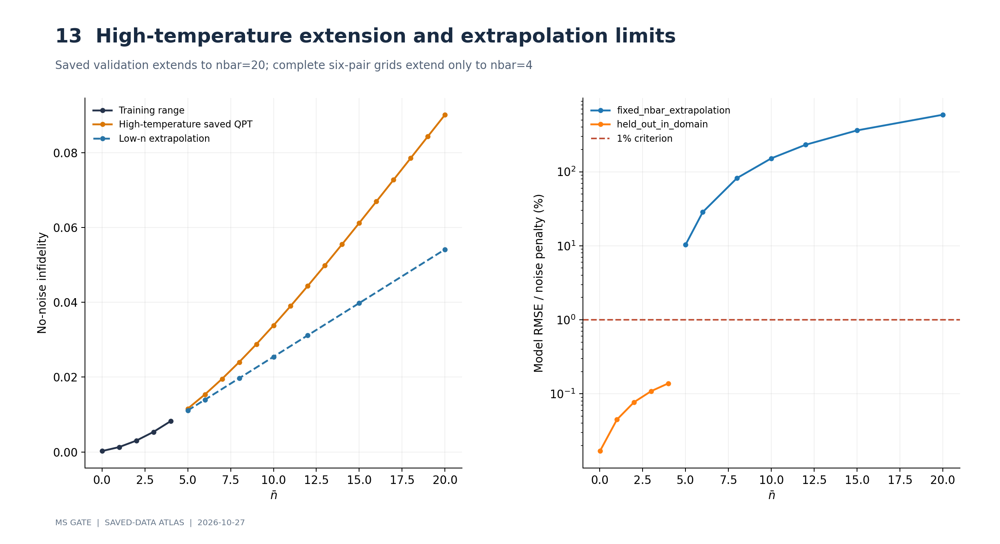

高温域にも無散逸16点と4ノイズ同時作用84点がある。低温データからの外挿は、保存された1%判定でnbar=4が最後の合格点、5が最初の不合格点。これはそのモデル・離散検証条件の適用限界であり、物理的な相転移や普遍的な臨界温度ではない。

出典: `results/noise_rate_nbar_sweep/four_noise_nbar_critical_search/high_nbar_model_predictions.csv`, `results/noise_rate_nbar_sweep/four_noise_nbar_critical_search/nbar_critical_curve.csv`, `results/noise_rate_nbar_sweep/four_noise_nbar_critical_search/all_noise_zero/validation_qpt_summary.csv`

## 14 Initial phonon number: three resolved error components

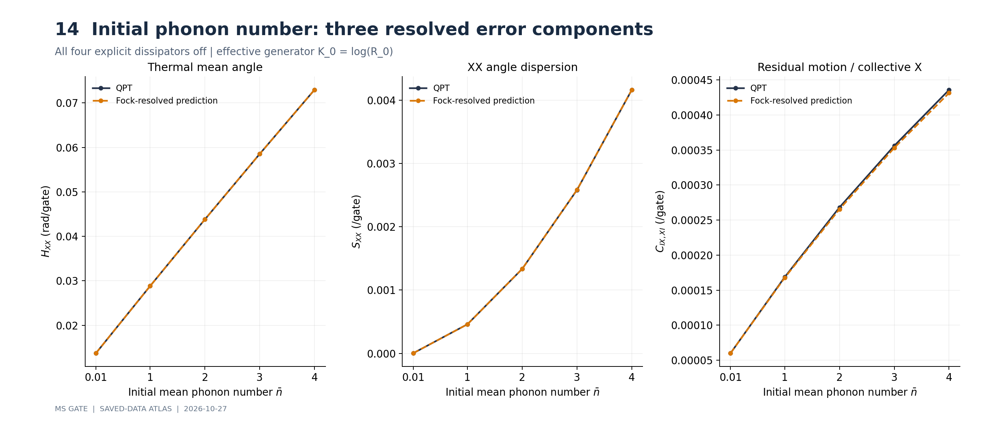

初期熱分布だけの効果を、平均XX角のずれ、XX角のばらつき、残留運動による集団X成分に分ける。Fock分解予測とQPTの直接比較。無散逸でも有限LD補正により誤差が残る。この図のS_XXと集団XのC_IX,XIは別成分。

出典: `results/noise_error_structure/noise_free_fock_generator_comparison.csv`

## 15 Generator structure for all five inputs

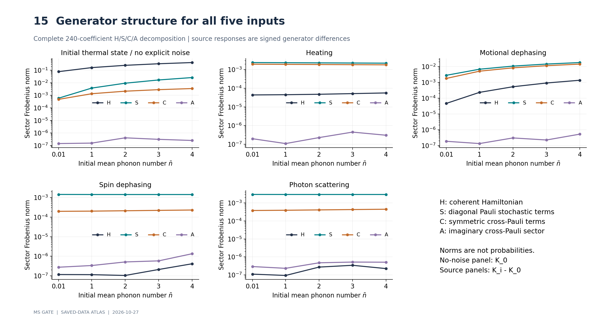

各散逸の基準レートでの応答をΔK_i=K_i-K_0として分解。初期熱状態のパネルのみK_0そのもの。縦軸は各セクターが作る行列のFrobeniusノルムで、確率や加算的誤差予算ではない。H/S/C/Aの係数全6000行を元CSVから参照できる。

出典: `results/noise_error_structure/full_taxonomy_coefficients.csv`, `results/noise_error_structure/full_taxonomy_overall_summary.csv`

## 16 Correlation modes: Initial thermal state / no explicit noise

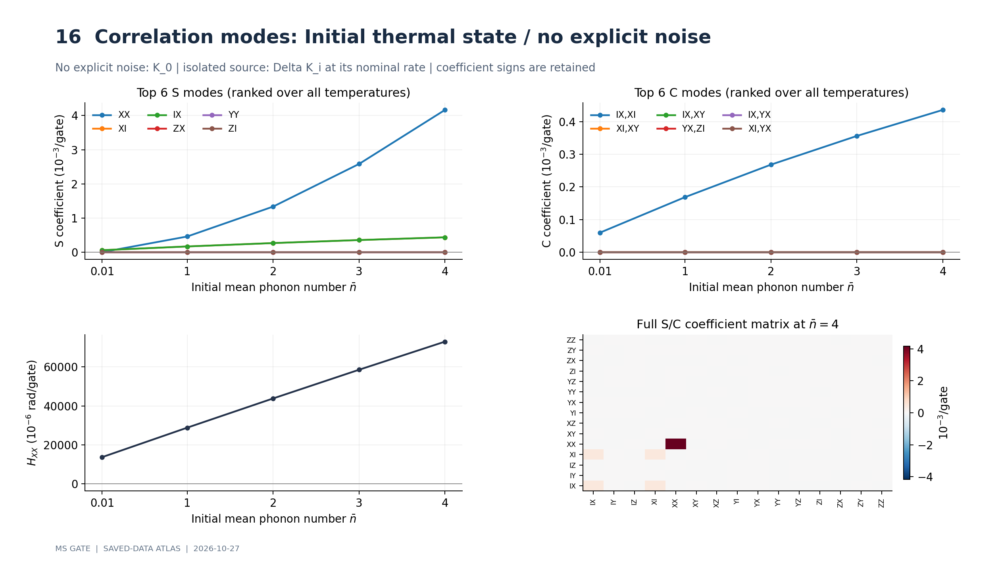

初期平均フォノン数（明示的な散逸なし）の主要成分。上段は温度全域の最大絶対値で選んだS/C各6モード、左下はH_XX、右下はnbar=4における15×15全S/C行列。右下の色範囲はこの入力内で設定しているため、他ページとの強度比較にはカラーバーを使う。ΔKの負係数は符号付き差分であり、単独の物理的崩壊率とは限らない。

出典: `results/noise_error_structure/full_taxonomy_coefficients.csv`

## 17 Correlation modes: Heating

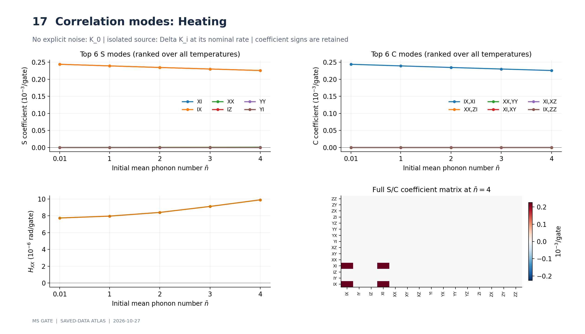

運動加熱の主要成分。上段は温度全域の最大絶対値で選んだS/C各6モード、左下はH_XX、右下はnbar=4における15×15全S/C行列。右下の色範囲はこの入力内で設定しているため、他ページとの強度比較にはカラーバーを使う。ΔKの負係数は符号付き差分であり、単独の物理的崩壊率とは限らない。

出典: `results/noise_error_structure/full_taxonomy_coefficients.csv`

## 18 Correlation modes: Motional dephasing

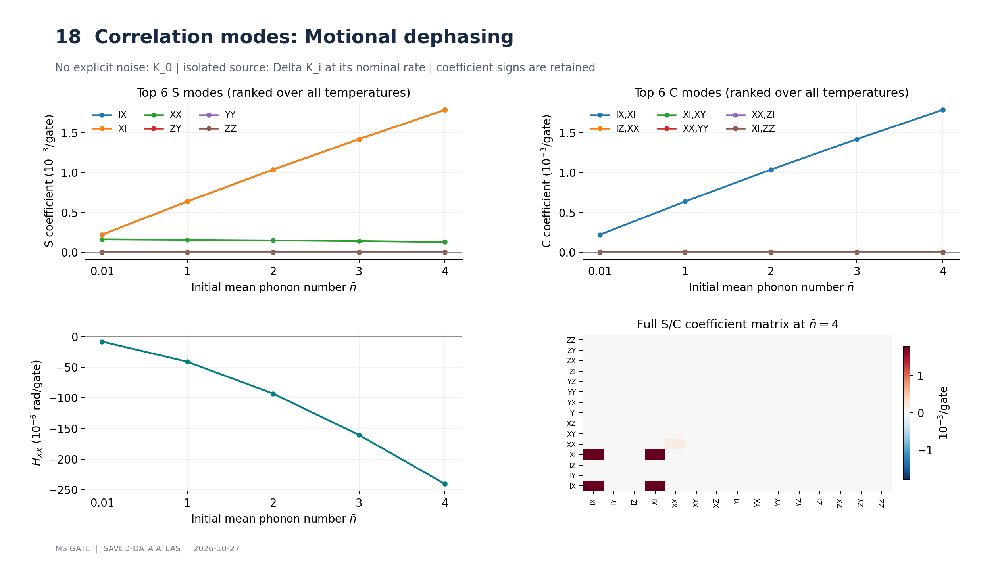

運動位相緩和の主要成分。上段は温度全域の最大絶対値で選んだS/C各6モード、左下はH_XX、右下はnbar=4における15×15全S/C行列。右下の色範囲はこの入力内で設定しているため、他ページとの強度比較にはカラーバーを使う。ΔKの負係数は符号付き差分であり、単独の物理的崩壊率とは限らない。

出典: `results/noise_error_structure/full_taxonomy_coefficients.csv`

## 19 Correlation modes: Spin dephasing

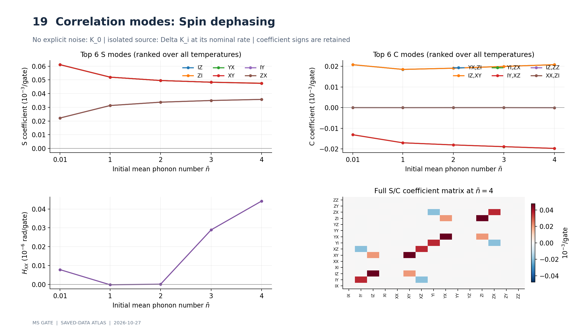

スピン位相緩和の主要成分。上段は温度全域の最大絶対値で選んだS/C各6モード、左下はH_XX、右下はnbar=4における15×15全S/C行列。右下の色範囲はこの入力内で設定しているため、他ページとの強度比較にはカラーバーを使う。ΔKの負係数は符号付き差分であり、単独の物理的崩壊率とは限らない。 スピン位相緩和・光散乱のH_XXは約1e-8 rad/gateの微小量で、この図だけで非ゼロの物理応答を確定しない。

出典: `results/noise_error_structure/full_taxonomy_coefficients.csv`

## 20 Correlation modes: Photon scattering

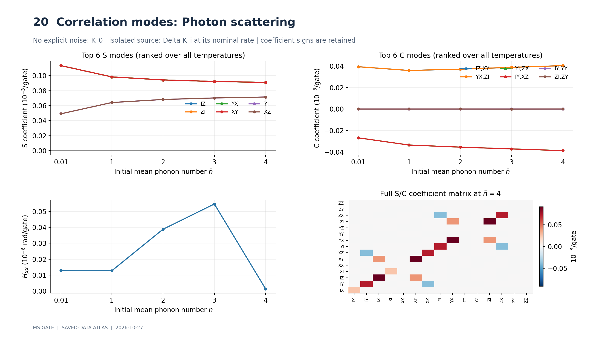

光散乱の主要成分。上段は温度全域の最大絶対値で選んだS/C各6モード、左下はH_XX、右下はnbar=4における15×15全S/C行列。右下の色範囲はこの入力内で設定しているため、他ページとの強度比較にはカラーバーを使う。ΔKの負係数は符号付き差分であり、単独の物理的崩壊率とは限らない。 スピン位相緩和・光散乱のH_XXは約1e-8 rad/gateの微小量で、この図だけで非ゼロの物理応答を確定しない。

出典: `results/noise_error_structure/full_taxonomy_coefficients.csv`

## 21 Does the correlation structure survive rate changes?

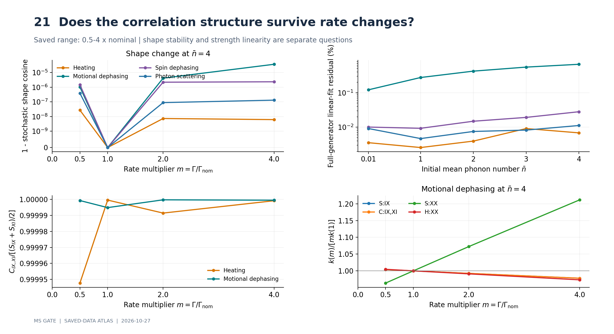

主要な確率的モードの向きはレートを変えてもほぼ保存される。運動ノイズではC_IX,XIと局所X係数の平均の比がほぼ1で、集団X構造を保つ。一方、運動位相緩和の高温・高レートではS_XXが線形外挿から増え、集団X係数はやや減る。左上はゼロを表示できるsymlog軸。

出典: `results/rate_hsca_structure/rate_structure_metrics.csv`, `results/rate_hsca_structure/rate_matrix_linearity.csv`

## 22 Pairwise response inside the diagonal-Pauli fit

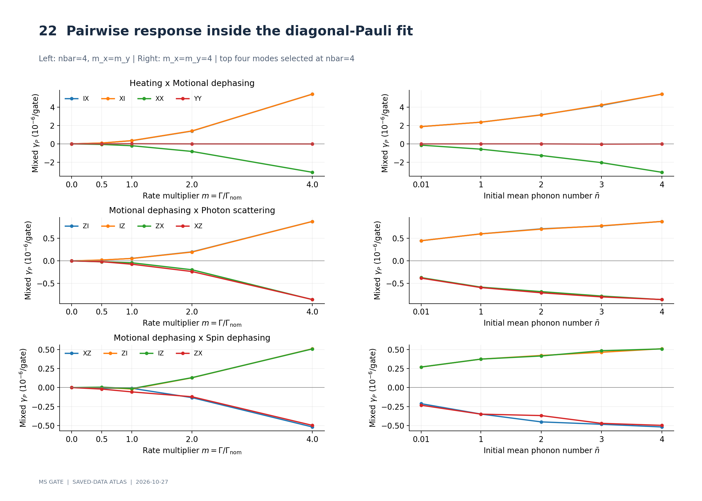

生成子を保存した上位3ペアについて、対角Pauli散逸フィット係数の混合差分を表示。これは完全H/S/C/A混合生成子の全成分ではなく、対角Pauli部分へのフィット内の結果。全6ペアの完全な生成子解析が完了したことを意味しない。

出典: `results/error_generator_rate_nbar/top3_pairwise_generator/pairwise_generator_interactions.csv`, `results/error_generator_rate_nbar/top3_pairwise_generator/config.json`

## 23 Small-rate mixed derivatives: numerical stability check

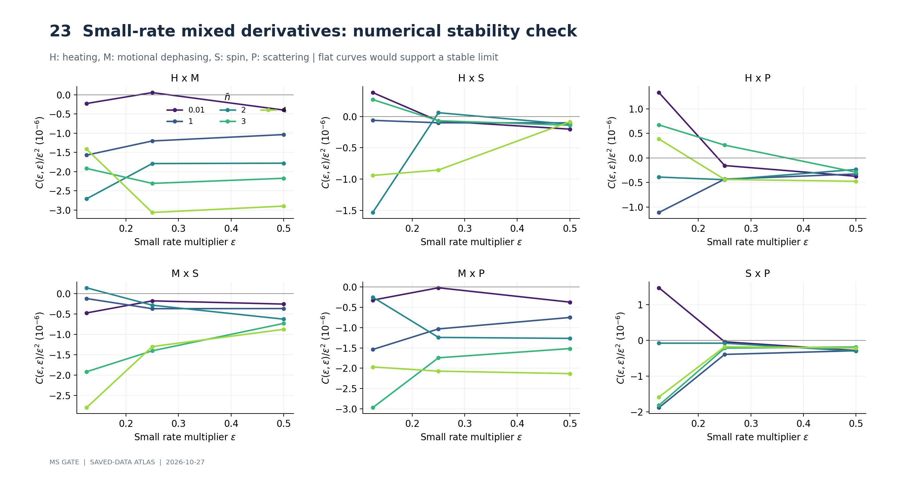

ゼロレート近傍の混合係数を差分幅ごとに比較。差分をepsilonの2乗で割るため、元の数値誤差が増幅される。曲線が水平に収束していない条件があり、外挿値の符号や桁数を確定した物理量として扱わない。

出典: `results/noise_rate_nbar_sweep/pairwise_perturbative_kappa/perturbative_kappa_raw.csv`, `results/noise_rate_nbar_sweep/pairwise_perturbative_kappa/perturbative_kappa_extrapolated.csv`

## 24 Model order and numerical checks

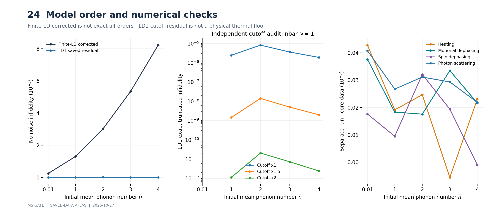

LD1の無散逸残差は基底次元を増やすと減少する。nbar=0.01の保存値1e-16は下限処理によるため、中央の対数比較には含めない。右は別保存系列の単独ノイズ計算との実測差で、元系列を混合して上書きしない。主たる有限LDの温度依存はこの差より大きいが、微小なペア差分の収束を保証する図ではない。

出典: `results/noise_rate_nbar_sweep/noise_free_diagnostics/full_vs_lamb_dicke/full_vs_lamb_dicke_summary.csv`, `results/noise_rate_nbar_sweep_ld1/evaluation/cutoff_audit/exact_cutoff_comparison.csv`, `results/single_mode_ms_gate_infidelity/single_noise/ld2/summary.csv`, `results/noise_rate_nbar_sweep/four_noise_reconstruction/four_noise_single_components.csv`

## 25 Motional-dephasing nonlinear response: model checks

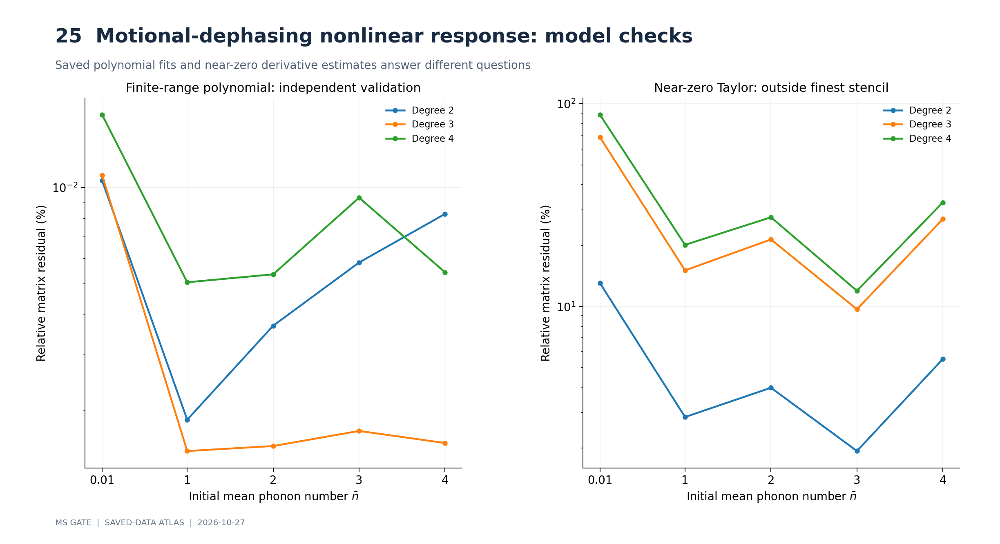

運動位相緩和の高次レートモデルの保存検証。左は有限範囲の多項式フィットの独立検証、右はゼロ近傍Taylor係数を推定した最小ステンシルの外側での検証。良好な有限範囲フィットだけで高階微分の収束を主張しない。

出典: `results/motional_dephasing_polynomial/polynomial_matrix_validation_metrics.csv`, `results/motional_dephasing_polynomial/dyson_frechet_taylor/taylor_truncation_summary.csv`

## 26 Single-source calculations: comparison of model order

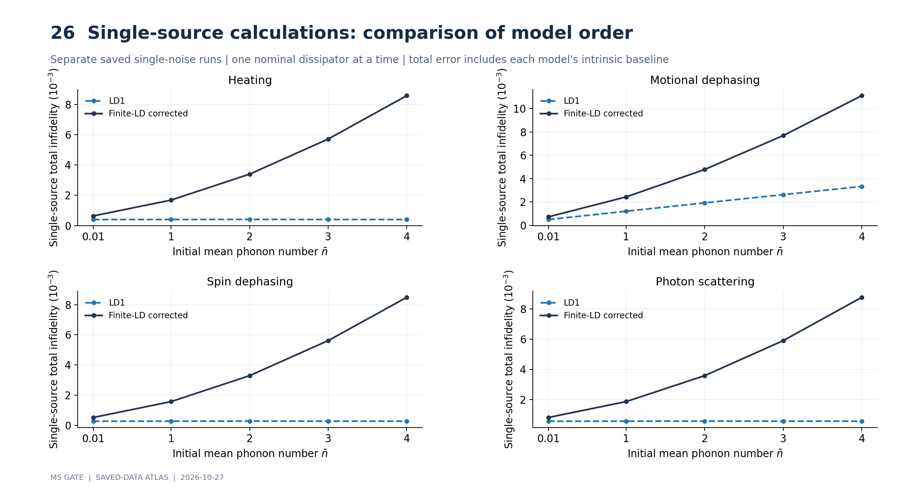

別保存系列にあるLD1と有限LD補正モデルの単独ノイズ計算、計40点。表示は単独ノイズを入れた総誤差I_iで、無散逸基準を引いた増分ではない。したがって有限LDモデルの全パネルに共通する温度増加を、その散逸だけの効果と解釈しない。単独増分の比較は図1・2を参照。

出典: `results/single_mode_ms_gate_infidelity/single_noise/ld1/summary.csv`, `results/single_mode_ms_gate_infidelity/single_noise/ld2/summary.csv`